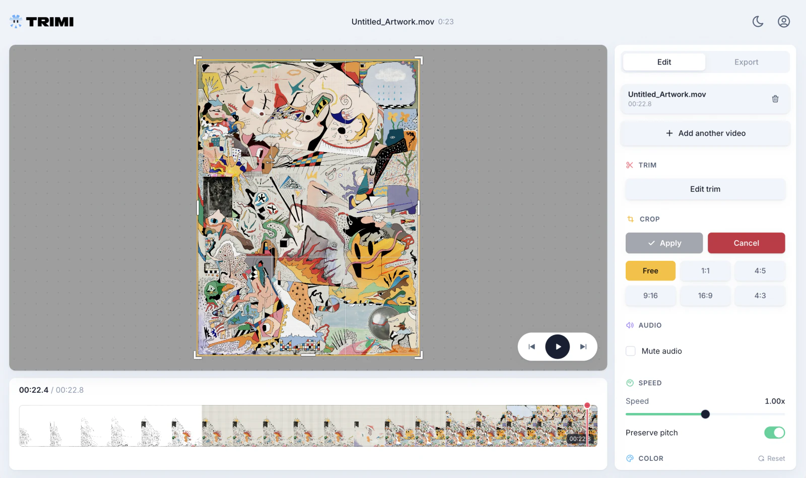

<p align="center">
  <picture>
    <source media="(prefers-color-scheme: dark)" srcset="app/src/assets/trimi-logo-dark.png">
    
  </picture>
</p>

<h1 align="center">Simple video edits. Free and open source.</h1>

<p align="center">
  Trim, crop, and polish your videos right in your browser.<br>
  No account. No activation key. Your videos stay on your device.
</p>

<p align="center">
  <a href="https://editor.trimi.app/"><strong>Enter the editor ↗</strong></a>
  &nbsp; · &nbsp;
  <a href="https://trimi.app/">Website</a>
  &nbsp; · &nbsp;
  <a href="LICENSE">MIT license</a>
</p>

[](https://editor.trimi.app/)

<p align="center"><sub>Crop and reframe your video, with editing tools and the timeline in one place.</sub></p>

## A small editor for everyday edits

| Edit | Adjust | Export |
| --- | --- | --- |
| Trim and split clips | Color, speed, and audio | MP4 or GIF |
| Crop and reframe | Preserve pitch or mute audio | Choose size and quality |

All tools are free. Editing and export run locally in your browser, and you can run Trimi on your own server.

## Run locally

Use Node.js 22.12+ and npm.

```sh
git clone https://github.com/atormo/trimi.git
cd trimi/app
npm ci
npm run dev
```

Open the local address printed by Vite. No environment variables or API credentials are required.

## Build and check

From `app/`:

```sh
npm run lint
npm run build
npm run preview
```

Deploy `app/dist/` to a static host using HTTPS. Video decoding and export depend on browser codec support; a current Chromium-based browser is recommended. Large videos also depend on available device memory. Video editing and export happen locally; imported videos are not uploaded to a server. The hosted page can request fonts and the optional sample video.

Or build the included Nginx image from the repository root:

```sh
docker build -t trimi ./app
docker run --rm -p 8080:80 trimi
```

## Project layout

- `app/src/components/`: editor controls, video stage, and timeline
- `app/src/hooks/useVideoEditor.ts`: editor state and import handling
- `app/src/lib/export-engine/`: local MP4/GIF encoding
- `design/`: original design references

## Contributing

Issues and pull requests are welcome. Describe the problem and steps to reproduce it. For code changes, run lint and build, and check the affected editing/import/export flow with a small local video. Never commit credentials or private media.

## License and credits

Trimi's original code is available under the [MIT license](LICENSE). Dependencies retain their own licenses. The included wolf sample by Nicky Pe retains the Pexels license; see [sample credits](app/public/sample-wolf-source.txt). The MIT license does not relicense third-party media or dependencies.
